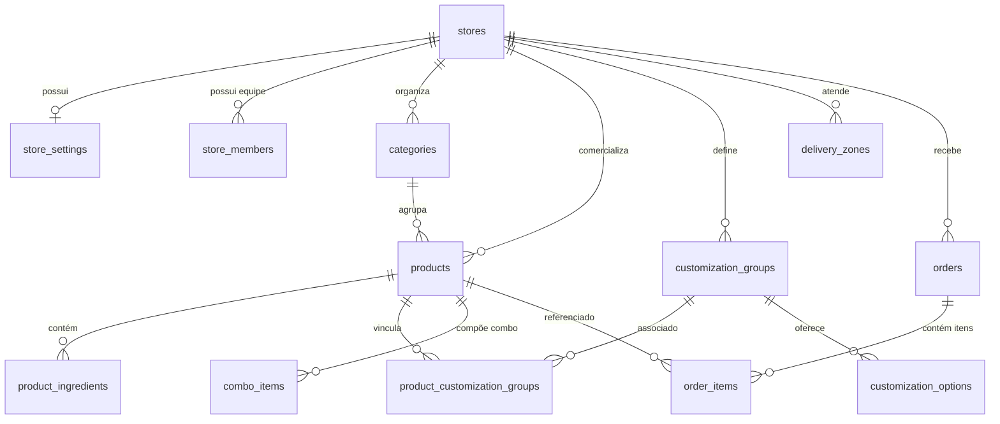

# BRASA BURGERS — Modelo de Dados e Arquitetura de Banco (PostgreSQL)

Este documento descreve a modelagem relacional, estratégias de isolamento White Label (Multi-tenancy), políticas de segurança em nível de linha (RLS) e integridade financeira do banco de dados da **BRASA BURGERS**.

---

## 1. Princípios Arquiteturais Fundamentais

1. **Chaves Primárias UUID:** Todos os registros utilizam identificadores universais únicos (`UUID`), gerados nativamente por `gen_random_uuid()`.
2. **Isolamento White Label:** Todas as tabelas que contêm recursos de uma loja apontam diretamente para `stores.id` via chave estrangeira com `ON DELETE CASCADE`.
3. **Integridade Financeira em Centavos:** Não são utilizados tipos de ponto flutuante (`FLOAT` ou `DOUBLE`). Todos os valores monetários (`base_price_cents`, `promo_price_cents`, `delivery_fee_cents`, `total_cents`, etc.) são armazenados estritamente como números inteiros (`INTEGER`) representando centavos, com restrições `CHECK (campo >= 0)`.
4. **Atualização Automática de Timestamps:** Todas as tabelas possuem gatilhos de `BEFORE UPDATE` executando `update_updated_at_column()` para manter `updated_at` sincronizado.
5. **Segurança em Nível de Linha (RLS):** Habilitada em 100% das tabelas. Visitantes anônimos possuem permissão de leitura apenas no catálogo ativo; membros autenticados gerenciam exclusivamente os registros pertencentes à sua respectiva loja.

---

## 2. Diagrama Entidade-Relacionamento (ERD)

---

## 3. Especificação das Tabelas

### 3.1. Núcleo White Label

#### `stores`
Armazena os inquilinos (lojas/hamburguerias) da plataforma.
- `id` (UUID, PK)
- `name` (TEXT): Nome comercial da loja.
- `slug` (TEXT, UNIQUE): Identificador amigável de rota / subdomínio.
- `cnpj` (TEXT)
- `phone` (TEXT)
- `whatsapp` (TEXT): Número de contato e envio de pedidos.
- `email` (TEXT)
- `is_active` (BOOLEAN): Controla o status ativo/inativo global da loja.
- `created_at`, `updated_at` (TIMESTAMPTZ)

#### `store_settings`
Configurações operacionais, logísticas, horários e identidade visual da loja.
- `id` (UUID, PK)
- `store_id` (UUID, FK -> stores.id, UNIQUE)
- `slogan`, `description` (TEXT)
- `currency` (TEXT): Padrão `'BRL'`.
- `locale` (TEXT): Padrão `'pt-BR'`.
- `opening_hours` (JSONB): Matriz de horários semanais.
- `delivery_fee_cents` (INTEGER): Taxa de entrega base.
- `min_order_cents` (INTEGER): Valor mínimo de pedido.
- `free_delivery_threshold_cents` (INTEGER): Limite para frete grátis.
- `estimated_delivery_time_min`, `estimated_delivery_time_max` (INTEGER)
- `allow_delivery`, `allow_pickup`, `allow_advance_orders` (BOOLEAN)
- `address_street`, `address_number`, `address_neighborhood`, `address_city`, `address_state`, `address_zip` (TEXT)
- `social_links` (JSONB): Links de redes sociais.
- `brand_colors` (JSONB): Paleta Dark Premium (background, surface, primary, secondary, cream).
- `accepted_payment_methods` (TEXT[]): Métodos aceitos (`pix`, `dinheiro`, `cartao_entrega`).

#### `store_members`
Vínculo de operadores e administradores com cada loja.
- `id` (UUID, PK)
- `store_id` (UUID, FK -> stores.id)
- `user_id` (UUID -> auth.users.id)
- `role` (TEXT): `'owner'`, `'admin'` ou `'operator'`.
- Restrição: `UNIQUE (store_id, user_id)`.

---

### 3.2. Catálogo e Produtos

#### `categories`
- `id` (UUID, PK)
- `store_id` (UUID, FK -> stores.id)
- `name` (TEXT)
- `slug` (TEXT)
- `description` (TEXT)
- `sort_order` (INTEGER)
- `is_active` (BOOLEAN)
- Restrição: `UNIQUE (store_id, slug)`.

#### `products`
- `id` (UUID, PK)
- `store_id` (UUID, FK -> stores.id)
- `category_id` (UUID, FK -> categories.id)
- `name` (TEXT)
- `slug` (TEXT)
- `description` (TEXT)
- `base_price_cents` (INTEGER)
- `promo_price_cents` (INTEGER, NULLABLE)
- `image_url` (TEXT)
- `badge` (TEXT): Tags como "Clássico", "Mais pedido", "Novo".
- `is_active`, `is_featured` (BOOLEAN)
- `sort_order`, `prep_time_min`, `calories`, `serves` (INTEGER)
- Restrição: `UNIQUE (store_id, slug)`.

#### `product_ingredients`
Ingredientes listados do produto que o cliente pode remover no pedido.
- `id` (UUID, PK)
- `product_id` (UUID, FK -> products.id)
- `name` (TEXT)
- `is_removable` (BOOLEAN)
- `sort_order` (INTEGER)

#### `customization_groups`
Grupos de personalização (adicionais, remoções de itens ou escolhas obrigatórias).
- `id` (UUID, PK)
- `store_id` (UUID, FK -> stores.id)
- `name` (TEXT)
- `description` (TEXT)
- `type` (TEXT): `'addition'`, `'removal'` ou `'choice'`.
- `min_selections`, `max_selections` (INTEGER)
- `is_required` (BOOLEAN)
- `sort_order` (INTEGER)

#### `customization_options`
Opções disponíveis dentro de cada grupo.
- `id` (UUID, PK)
- `group_id` (UUID, FK -> customization_groups.id)
- `name` (TEXT)
- `description` (TEXT)
- `price_cents` (INTEGER)
- `is_default`, `is_available` (BOOLEAN)
- `max_quantity`, `sort_order` (INTEGER)

#### `product_customization_groups`
Tabela associativa entre produtos e grupos de customização.
- `id` (UUID, PK)
- `product_id` (UUID, FK -> products.id)
- `group_id` (UUID, FK -> customization_groups.id)
- `sort_order` (INTEGER)
- Restrição: `UNIQUE (product_id, group_id)`.

#### `combo_items`
Componentes integrados em itens do tipo Combo.
- `id` (UUID, PK)
- `combo_product_id` (UUID, FK -> products.id)
- `group_name` (TEXT): Ex: `'Bebida'`, `'Acompanhamento'`.
- `included_product_id` (UUID, FK -> products.id)
- `default_product_id` (UUID, FK -> products.id)
- `sort_order` (INTEGER)

---

### 3.3. Logística e Zonas de Entrega

#### `delivery_zones`
- `id` (UUID, PK)
- `store_id` (UUID, FK -> stores.id)
- `name` (TEXT): Nome do bairro ou região.
- `min_distance_km`, `max_distance_km` (NUMERIC)
- `fee_cents` (INTEGER): Taxa calculada para o bairro.
- `estimated_minutes` (INTEGER)
- `is_active` (BOOLEAN)

---

### 3.4. Pedidos

#### `orders`
- `id` (UUID, PK)
- `store_id` (UUID, FK -> stores.id)
- `order_number` (TEXT): Identificador legível (ex: `#BB-1001`).
- `customer_name`, `customer_phone`, `customer_email` (TEXT)
- `order_type` (TEXT): `'delivery'`, `'pickup'` ou `'dine_in'`.
- `status` (TEXT): `'pending'`, `'confirmed'`, `'preparing'`, `'ready'`, `'out_for_delivery'`, `'delivered'`, `'cancelled'`.
- `delivery_address` (JSONB)
- `payment_method` (TEXT): `'pix'`, `'dinheiro'`, `'cartao_entrega'`.
- `payment_status` (TEXT): `'pending'`, `'paid'`, `'failed'`.
- `change_for_cents`, `subtotal_cents`, `delivery_fee_cents`, `discount_cents`, `total_cents` (INTEGER)
- `notes`, `whatsapp_message` (TEXT)

#### `order_items`
- `id` (UUID, PK)
- `order_id` (UUID, FK -> orders.id)
- `product_id` (UUID, FK -> products.id)
- `product_name` (TEXT)
- `unit_price_cents`, `quantity`, `subtotal_cents` (INTEGER)
- `customizations` (JSONB): Histórico imutável dos adicionais e remoções escolhidos.
- `notes` (TEXT)

---

## 4. Políticas de Segurança (Row Level Security - RLS)

- **Função de Segurança:** `public.is_store_member(lookup_store_id, lookup_user_id)` verifica se o usuário autenticado pertence à equipe da loja.
- **Catálogo Público:** Clientes anônimos têm acesso somente de leitura (`SELECT`) a `stores`, `store_settings`, `categories`, `products`, `product_ingredients`, `customization_groups`, `customization_options` e `delivery_zones` onde `is_active = true`.
- **Checkout Seguro:** Clientes anônimos podem realizar `INSERT` em `orders` e `order_items` durante o checkout.
- **Painel Administrativo:** Apenas membros validados (`owner`, `admin`, `operator`) possuem permissões completas de escrita, edição e exclusão nos recursos de sua respectiva loja.

